# TravelMemory – MERN Deployment on AWS EC2 with ALB and Cloudflare

Deployment of the [TravelMemory](https://github.com/UnpredictablePrashant/TravelMemory) MERN application on Amazon EC2, with an nginx reverse proxy, two load-balanced instances across Availability Zones, MongoDB Atlas, and a custom domain through Cloudflare.

**Author:** Kamal Vasvani

| Entry point | URL | Path |
|---|---|---|
| Main (load balanced) | https://travelmemory.kamalvasvani.com | Cloudflare → CNAME → ALB → EC2-1 / EC2-2 |
| Direct frontend instance | https://travelmemory-fe.kamalvasvani.com | Cloudflare → A record → EC2-1 |

---

## Table of contents

1. [Architecture](#1-architecture)
2. [Technology and resources](#2-technology-and-resources)
3. [Repository changes](#3-repository-changes)
4. [Step-by-step deployment](#4-step-by-step-deployment)
5. [Security measures](#5-security-measures)
6. [Scalability and resilience](#6-scalability-and-resilience)
7. [Issues faced and how they were solved](#7-issues-faced-and-how-they-were-solved)
8. [Known limitations and future improvements](#8-known-limitations-and-future-improvements)
9. [Cost and teardown](#9-cost-and-teardown)

---

## 1. Architecture

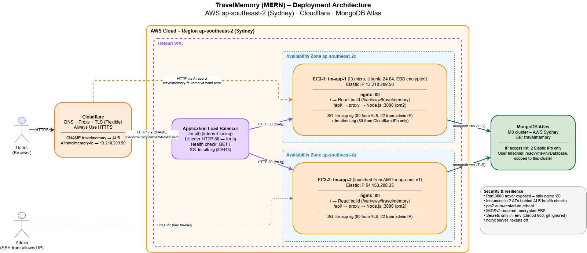

The editable draw.io source is [`docs/architecture.drawio`](docs/architecture.drawio).

**Request flow**

1. The user opens `https://travelmemory.kamalvasvani.com`. Cloudflare terminates HTTPS and forwards the request over HTTP to the Application Load Balancer (CNAME record).
2. The ALB forwards the request to one of two healthy EC2 instances in different Availability Zones (target group `tm-tg`).
3. On each instance, **nginx** listens on port 80:
   - `/` serves the static React production build from `/var/www/travelmemory`.
   - `/api/` is reverse-proxied to the Node.js/Express backend on `127.0.0.1:3000`, managed by **pm2**.
4. The backend reads and writes data in **MongoDB Atlas** (M0 cluster in the same AWS region, Sydney).
5. `https://travelmemory-fe.kamalvasvani.com` (A record) reaches EC2-1 directly through Cloudflare. EC2-1 only accepts this traffic from Cloudflare's IP ranges.

Because the frontend calls the backend through the **relative path `/api`**, the same build works through the ALB, the custom domains and the instance IP, with no CORS or mixed-content issues.

---

## 2. Technology and resources

| Component | Details |
|---|---|
| Frontend | React (Create React App), production build served by nginx |
| Backend | Node.js 20 (v20.20.2) + Express, run by pm2 7.0.4 |
| Database | MongoDB Atlas M0 (free), AWS `ap-southeast-2` |
| Web server / reverse proxy | nginx 1.24.0 |
| OS | Ubuntu Server 24.04 LTS |
| Compute | 2 × EC2 `t3.micro`, 20 GiB gp3 encrypted EBS, IMDSv2 required |
| Load balancer | Application Load Balancer `tm-alb`, internet-facing, AZs 2a + 2c |
| DNS / TLS | Cloudflare (proxied records, Flexible SSL, Always Use HTTPS) |
| Region | AWS `ap-southeast-2` (Sydney) |

**AWS resources created**

| Resource | Name / ID | Notes |
|---|---|---|
| EC2 instance | `tm-app-1` (`i-0f20d1a08217c972e`) | AZ ap-southeast-2c, Elastic IP `13.210.209.50` |
| EC2 instance | `tm-app-2` (`i-031752abf0df686ab`) | AZ ap-southeast-2a, Elastic IP `54.153.208.35`, launched from AMI |
| AMI | `tm-app-ami-v1` (`ami-0d53bb595b7286cd1`) | Private, encrypted snapshot of `tm-app-1` |
| Target group | `tm-tg` | HTTP:80, health check `GET /` |
| Load balancer | `tm-alb` | Listener HTTP:80 → `tm-tg` |
| Security group | `tm-alb-sg` | Inbound 80, 443 from anywhere |
| Security group | `tm-app-sg` | Inbound 80 from `tm-alb-sg` only, 22 from admin IP only |
| Security group | `tm-direct-sg` | Inbound 80 from Cloudflare IPv4 ranges only (EC2-1 only) |
| Key pair | `tm-key` | RSA, used for SSH |

---

## 3. Repository changes

| File | Change |
|---|---|
| `frontend/src/url.js` | `baseUrl` changed to `"/api"` so the frontend talks to the backend through the nginx reverse proxy |
| `backend/.env.example` | Template for the backend environment variables (the real `.env` is never committed) |
| `deploy/nginx/travelmemory.conf` | nginx site configuration used on both instances |
| `docs/` | Architecture diagram and deployment screenshots |

`.gitignore` already excludes `.env`, so secrets cannot be committed by accident.

---

## 4. Step-by-step deployment

### Step 1 – Fork the repository

The original repository was forked so that all changes and documentation are kept in one place.

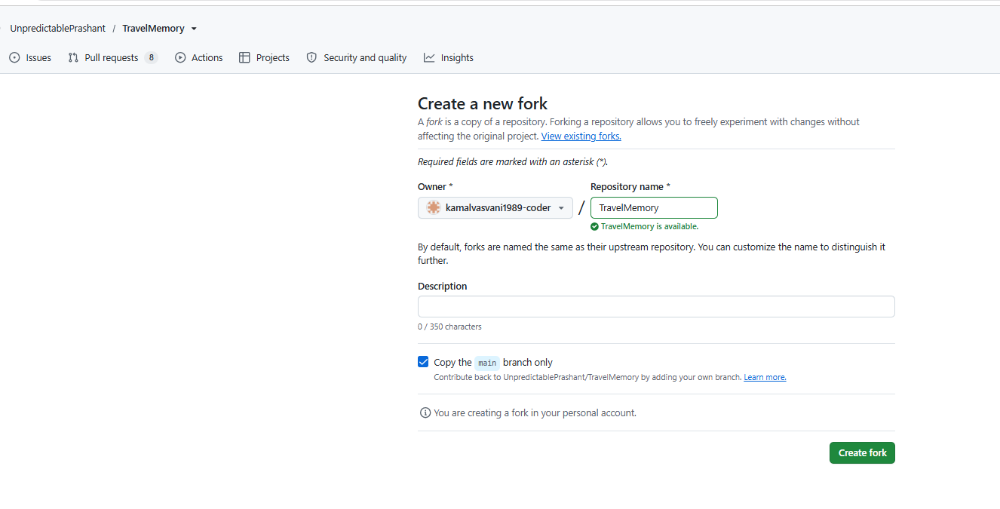
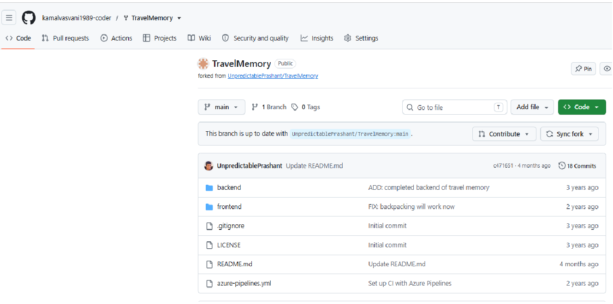

### Step 2 – Register the domain on Cloudflare

`kamalvasvani.com` was registered through Cloudflare Registrar, so it uses Cloudflare nameservers automatically and was active immediately. Two-factor authentication was enabled on the Cloudflare account.

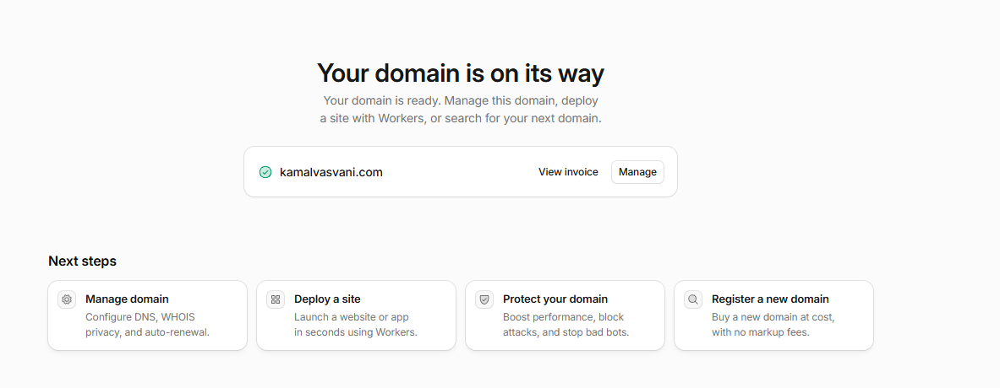
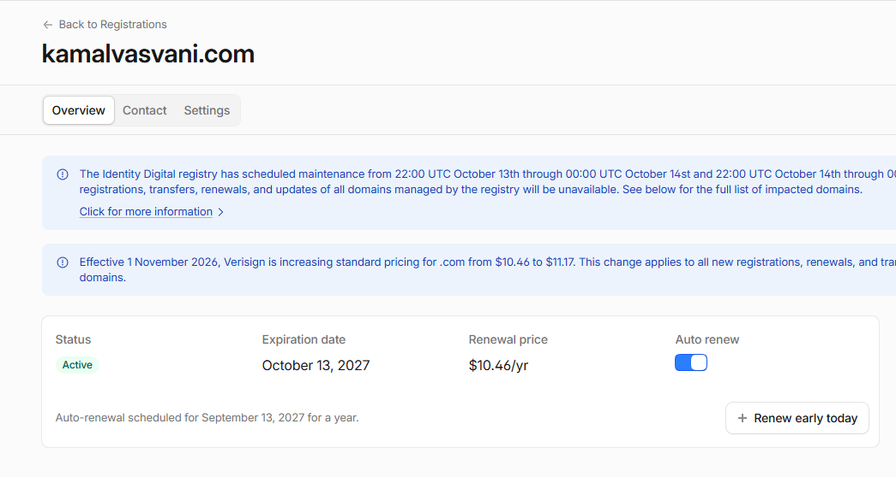
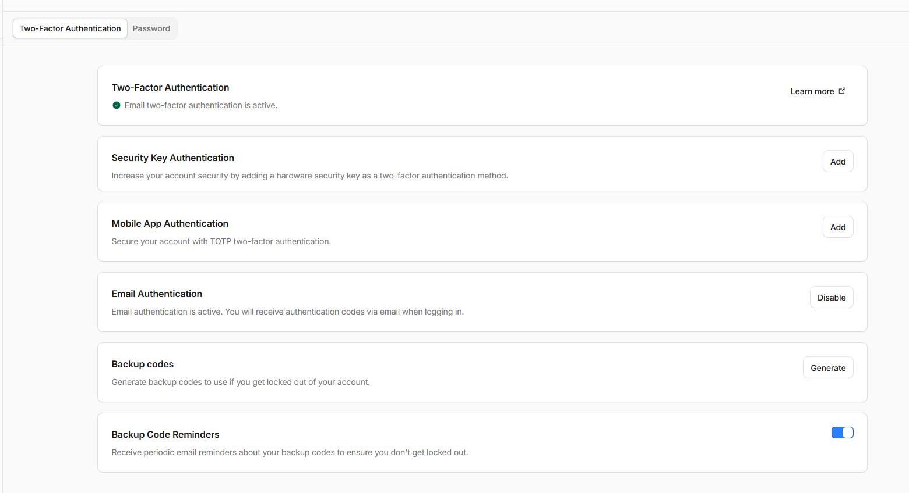

### Step 3 – Region choice

The AWS account is on the Free plan, which is locked to a single region: **Asia Pacific (Sydney) ap-southeast-2**. All AWS resources and the MongoDB Atlas cluster were therefore placed in Sydney, so that the application and the database are co-located and query latency stays low.

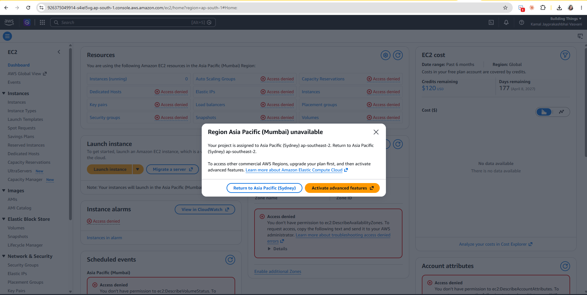

### Step 4 – Create the MongoDB Atlas database

1. Created a free **M0** cluster on **AWS, Sydney (ap-southeast-2)**, named `travelmemory-cluster`. "Automate security setup" and "Preload sample dataset" were unticked.
2. Created a dedicated database user `tmadmin` with an auto-generated alphanumeric password, the built-in role **readWriteAnyDatabase** (not Atlas admin), and access **restricted to `travelmemory-cluster` only**.
3. Copied the Node.js connection string and added the database name `travelmemory`:

```
mongodb+srv://tmadmin:<password>@travelmemory-cluster.xif5dih.mongodb.net/travelmemory?appName=travelmemory-cluster
```

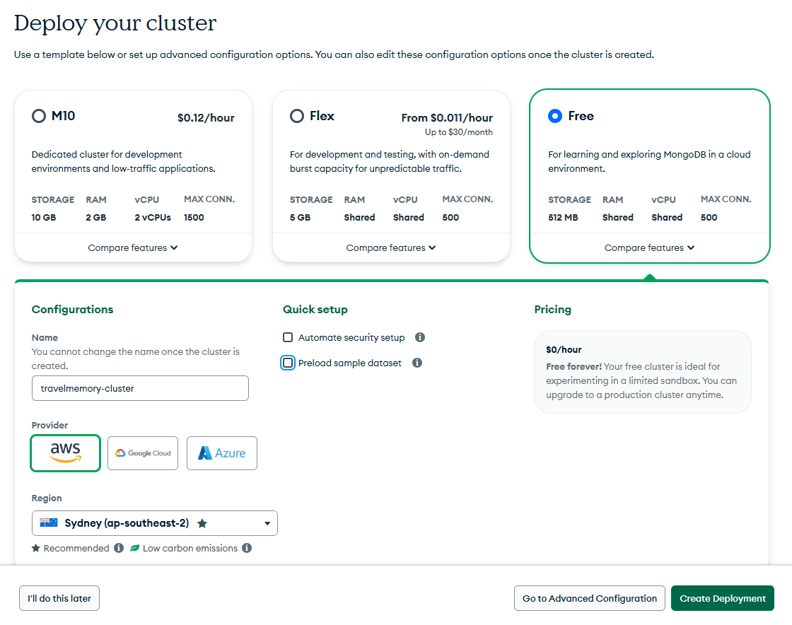
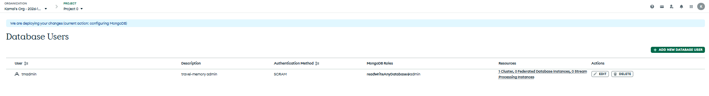
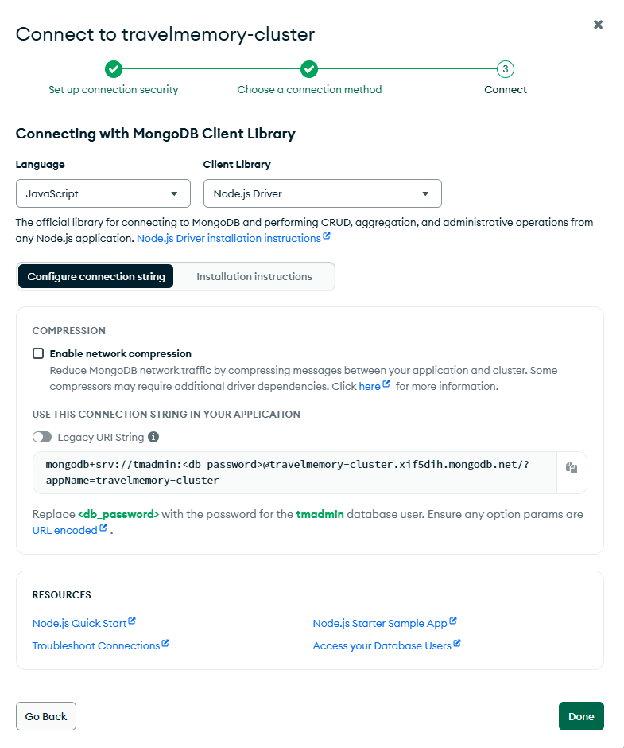

The IP access list was locked down later to the two EC2 Elastic IPs (see [Step 13](#step-13--lock-down-the-atlas-ip-access-list)).

### Step 5 – Security groups and key pair

**`tm-alb-sg`** – for the load balancer:

| Type | Port | Source |
|---|---|---|
| HTTP | 80 | 0.0.0.0/0 |
| HTTPS | 443 | 0.0.0.0/0 |

**`tm-app-sg`** – for the application instances:

| Type | Port | Source | Purpose |
|---|---|---|---|
| HTTP | 80 | `tm-alb-sg` | Only the ALB can reach the app |
| SSH | 22 | Admin IP /32 | Only the administrator can SSH |
| HTTP | 80 | Admin IP /32 | Temporary, for testing before the ALB existed (removed later) |

Port **3000 is not opened anywhere**; only nginx talks to Node.js, locally.

A key pair `tm-key` (RSA, `.ppk` for PuTTY) was created for SSH access.

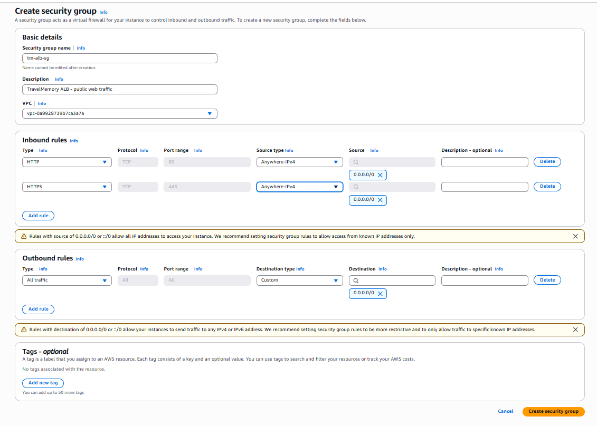
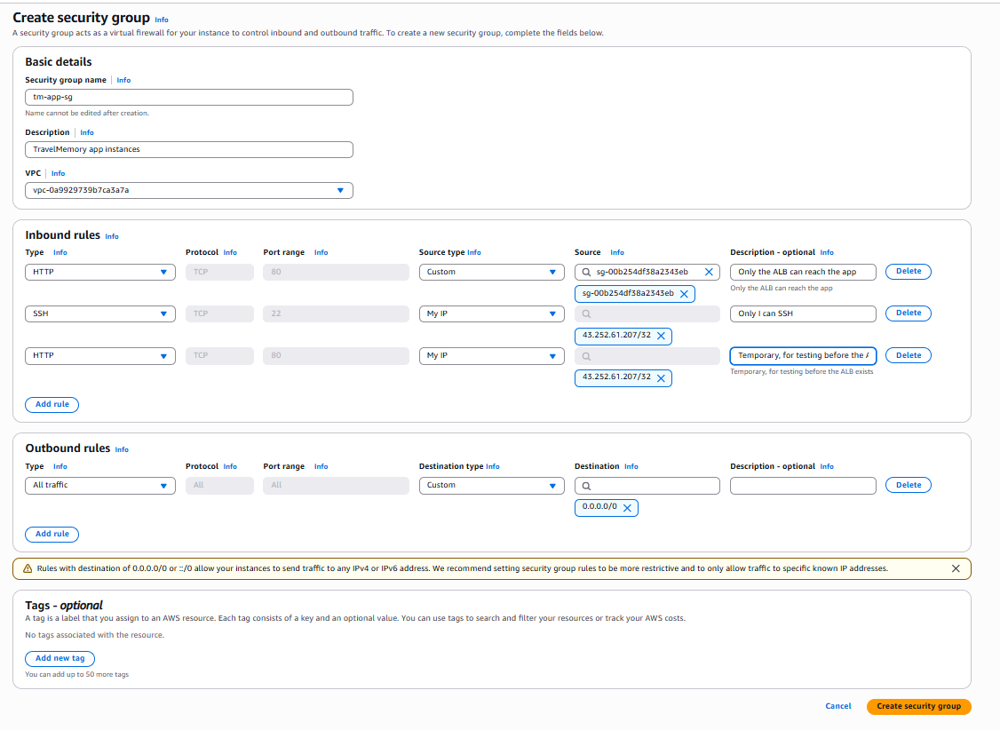
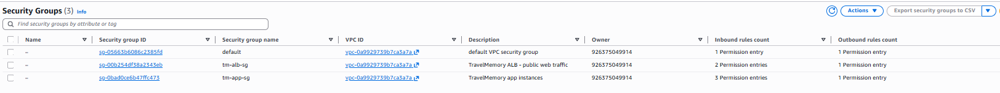
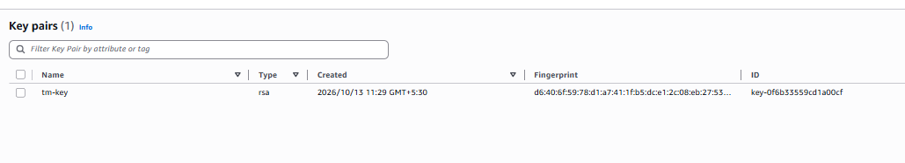

### Step 6 – Launch EC2-1 (`tm-app-1`)

| Setting | Value |
|---|---|
| AMI | Ubuntu Server 24.04 LTS |
| Instance type | t3.micro |
| Key pair | tm-key |
| Security group | tm-app-sg |
| Storage | 20 GiB gp3, **encrypted** with the `aws/ebs` KMS key |
| Public IP | Auto-assigned (later replaced by an Elastic IP) |

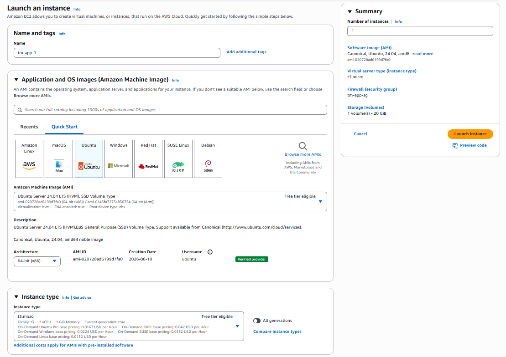
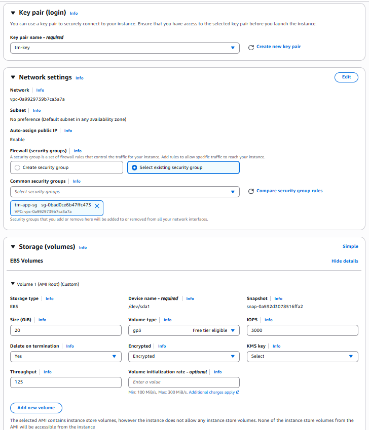
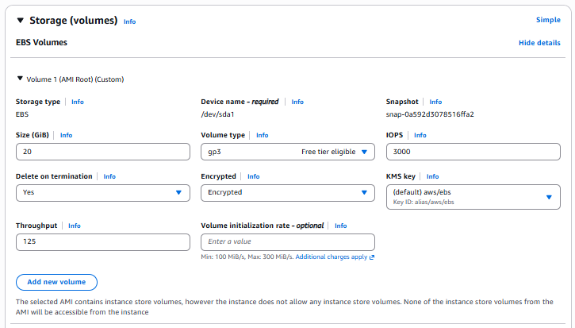
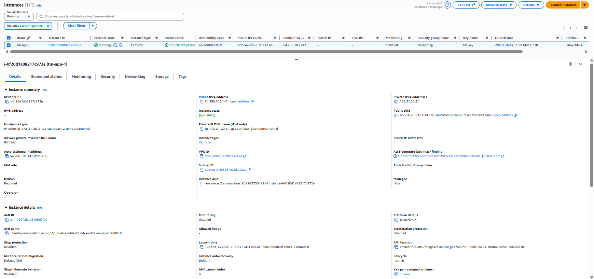

Connected over SSH with PuTTY (`ubuntu@<public-ip>`, key `tm-key.ppk`):

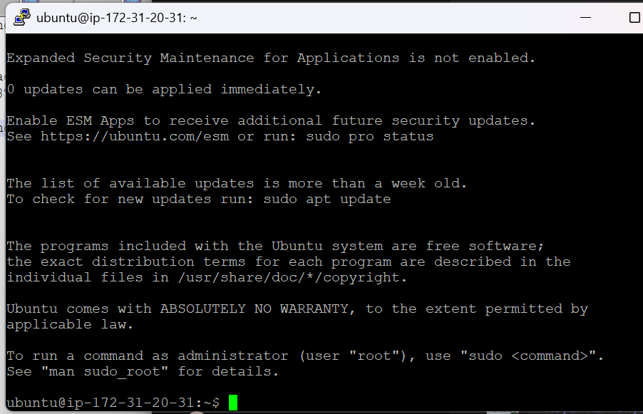

### Step 7 – Install the server tooling

```bash
# Update the OS
sudo apt update && sudo apt upgrade -y

# 2 GB swap – the React build runs out of memory on a 1 GB t3.micro without it
sudo fallocate -l 2G /swapfile
sudo chmod 600 /swapfile
sudo mkswap /swapfile
sudo swapon /swapfile
echo '/swapfile none swap sw 0 0' | sudo tee -a /etc/fstab

# Node.js 20, nginx, git
curl -fsSL https://deb.nodesource.com/setup_20.x | sudo -E bash -
sudo apt install -y nodejs nginx git

# pm2 process manager
sudo npm install -g pm2

# Verify
node -v && npm -v && nginx -v && git --version && pm2 -v && free -h
```

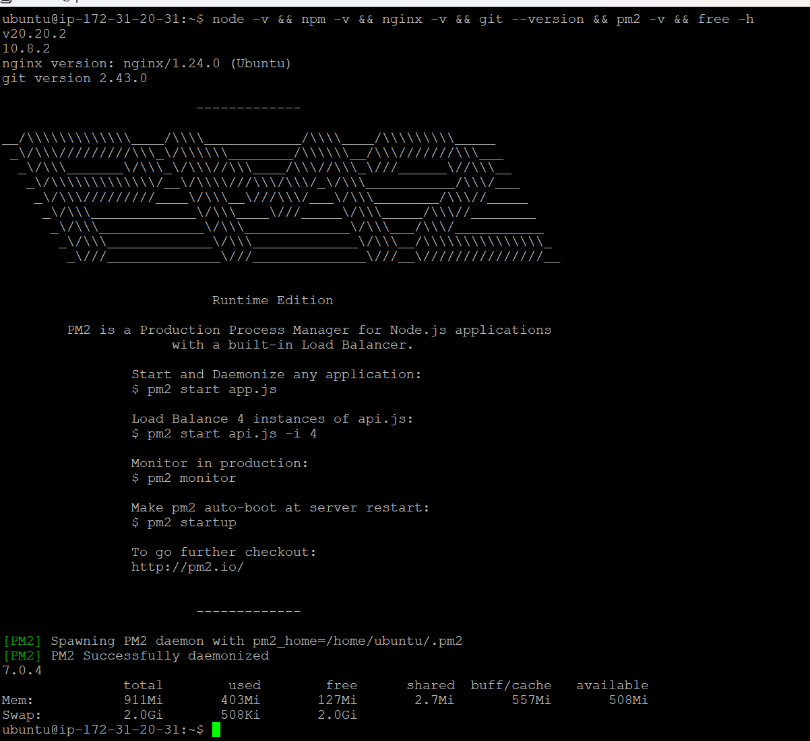

### Step 8 – Backend configuration

```bash
cd ~
git clone https://github.com/kamalvasvani1989-coder/TravelMemory.git
cd TravelMemory/backend
nano .env
```

`.env` contents (see `backend/.env.example`):

```
MONGO_URI='mongodb+srv://tmadmin:<password>@travelmemory-cluster.xif5dih.mongodb.net/travelmemory?appName=travelmemory-cluster'
PORT=3000
```

```bash
chmod 600 .env                          # only the ubuntu user can read the secrets
npm install
pm2 start index.js --name tm-backend
curl http://localhost:3000/trip         # returns [] – backend is up and connected to Atlas

pm2 startup                             # then run the "sudo env PATH=..." line it prints
pm2 save                                # backend now starts automatically after a reboot
```

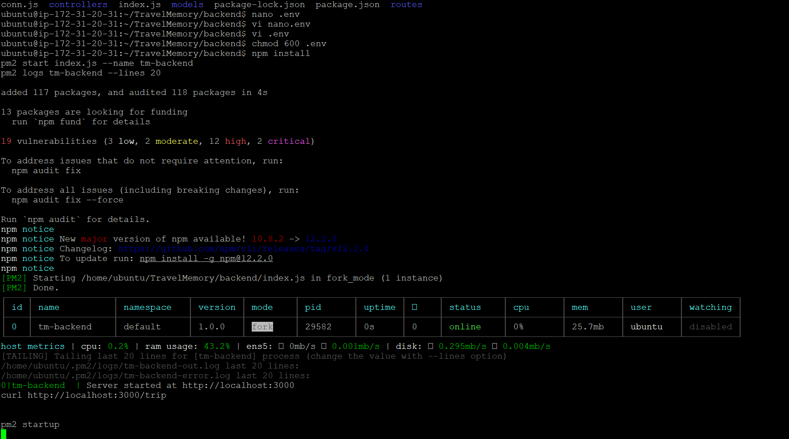
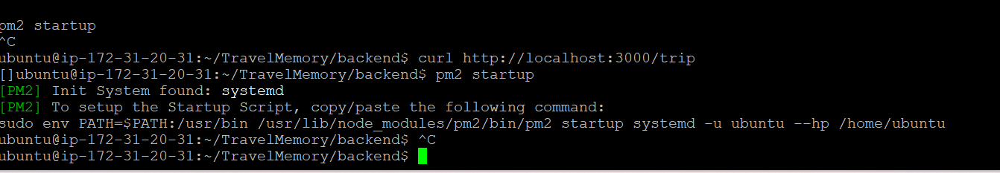
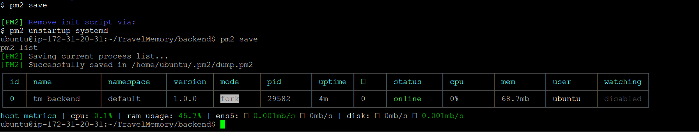

`npm install` reports vulnerabilities in the repository's older upstream dependencies. `npm audit fix --force` was deliberately **not** run, because it can introduce breaking major-version upgrades. See [Known limitations](#8-known-limitations-and-future-improvements).

### Step 9 – Connect the frontend to the backend (`url.js`)

Original `frontend/src/url.js`:

```js
export const baseUrl = process.env.REACT_APP_BACKEND_URL || "http://localhost:3001";
```

Updated:

```js
export const baseUrl = "/api";
```

The frontend now calls `/api/trip`, which nginx forwards to the backend. Using a relative path means one build works behind any hostname (ALB, both custom domains, raw IP) and avoids CORS and mixed-content problems.

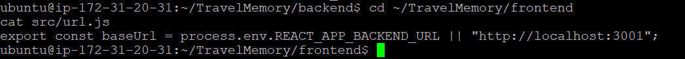
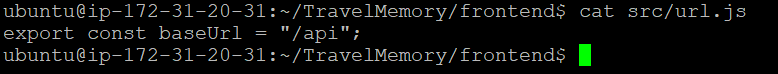

Build and publish the frontend:

```bash
cd ~/TravelMemory/frontend
npm install
npm run build
sudo mkdir -p /var/www/travelmemory
sudo cp -r build/* /var/www/travelmemory/
```

The build finished with two ESLint style warnings from the original code (an unused import and `==` instead of `===`). They do not affect the application.

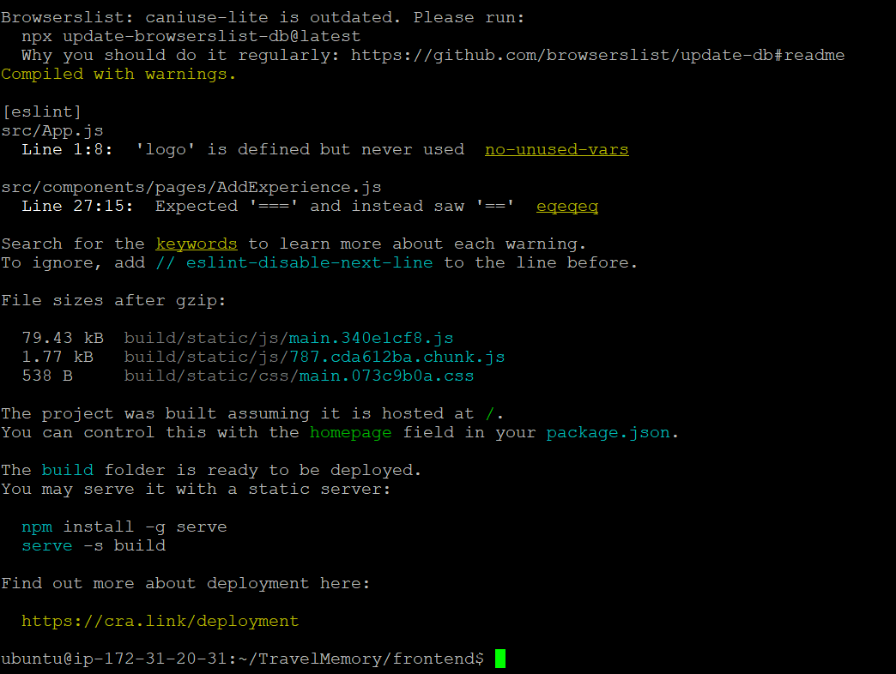
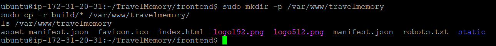

### Step 10 – nginx reverse proxy

`/etc/nginx/sites-available/travelmemory` (also in `deploy/nginx/travelmemory.conf`):

```nginx
server {
    listen 80 default_server;
    server_name _;
    server_tokens off;

    root /var/www/travelmemory;
    index index.html;

    # React frontend
    location / {
        try_files $uri /index.html;
    }

    # Backend API -> Node on port 3000 (the trailing slash strips /api)
    location /api/ {
        proxy_pass http://127.0.0.1:3000/;
        proxy_http_version 1.1;
        proxy_set_header Host $host;
        proxy_set_header X-Real-IP $remote_addr;
        proxy_set_header X-Forwarded-For $proxy_add_x_forwarded_for;
        proxy_set_header X-Forwarded-Proto $scheme;
    }
}
```

```bash
sudo ln -s /etc/nginx/sites-available/travelmemory /etc/nginx/sites-enabled/
sudo rm /etc/nginx/sites-enabled/default
sudo nginx -t
sudo systemctl reload nginx

curl -I http://localhost              # 200 OK – React app
curl http://localhost/api/trip        # backend through nginx
```

- `try_files $uri /index.html` lets React handle client-side routes such as `/addexperience`.
- `server_tokens off` hides the nginx version from response headers.

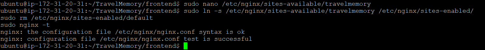
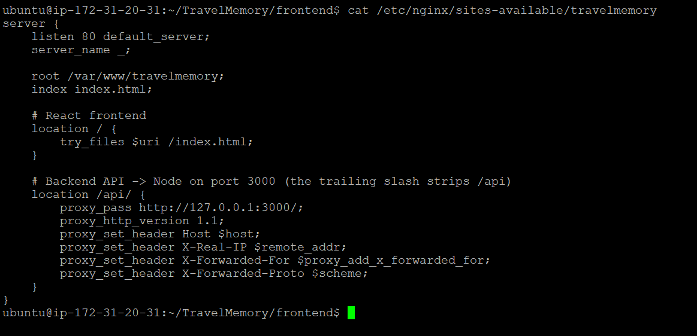
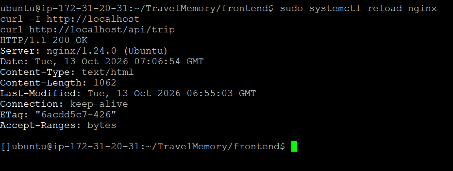
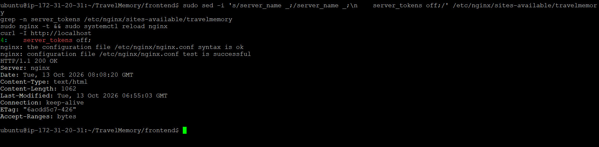

### Step 11 – End-to-end test

A trip was added through the **Add Experience** form. It was saved to Atlas and displayed on the home page, which proves the full chain: browser → nginx → Express → MongoDB Atlas.

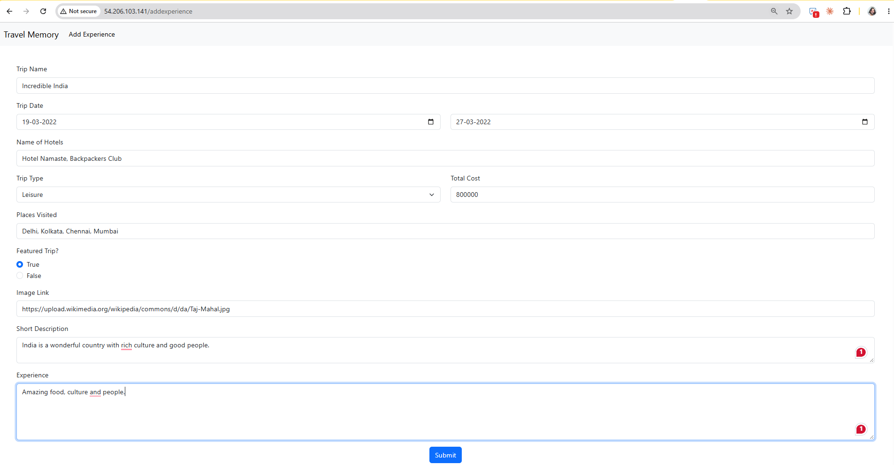
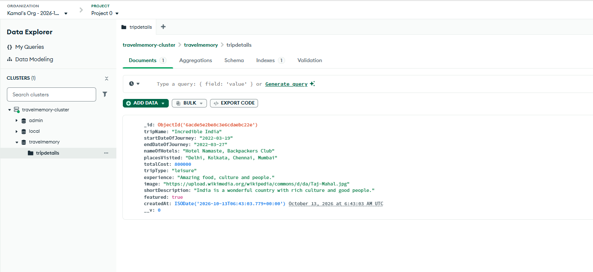
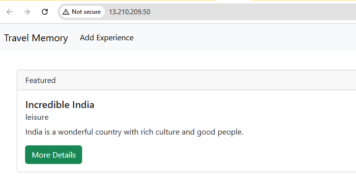

### Step 12 – Elastic IP, reboot test and AMI

1. Allocated an **Elastic IP** (`13.210.209.50`) and associated it with `tm-app-1`, so the A record and the Atlas allow list have an address that never changes.
2. **Reboot test:** after `sudo reboot`, pm2 brought `tm-backend` back online automatically and the API returned data, with no manual action.
3. Created the AMI **`tm-app-ami-v1`** from `tm-app-1`. It contains the OS, nginx configuration, React build, backend and pm2 setup, so new instances are exact copies.

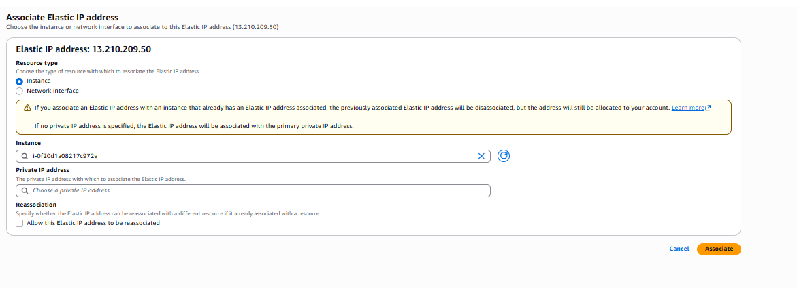
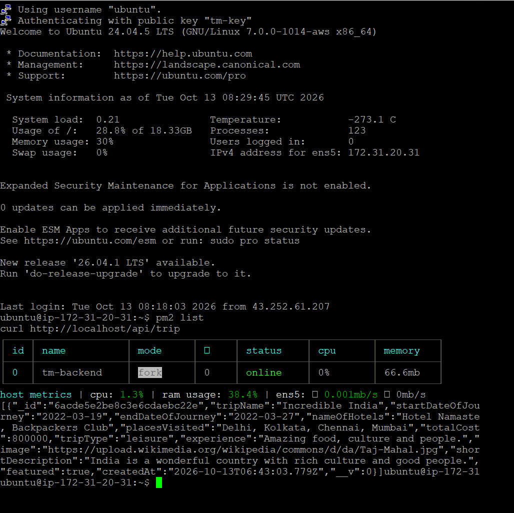
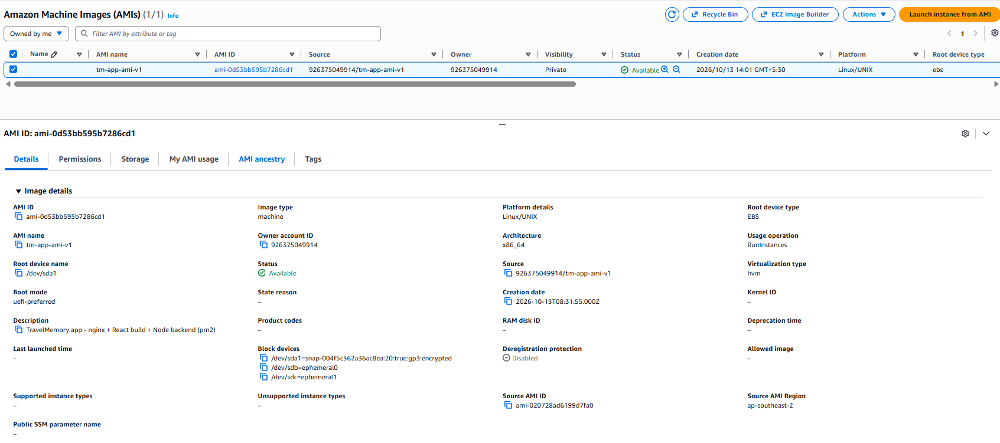

### Step 13 – Second instance and lock down the Atlas IP access list

1. Launched **`tm-app-2`** from `tm-app-ami-v1` in a **different Availability Zone** (`ap-southeast-2a`; `tm-app-1` is in `ap-southeast-2c`), with security group `tm-app-sg`.
2. Allocated Elastic IP `54.153.208.35` for it.
3. Added both Elastic IPs to the Atlas IP access list, then **removed `0.0.0.0/0` and the admin IP**. The database now only accepts connections from the two application servers.
4. Restarted the backend on `tm-app-2` (`pm2 restart tm-backend`) so it reconnected after its IP was allowed, and verified it returns the same data.

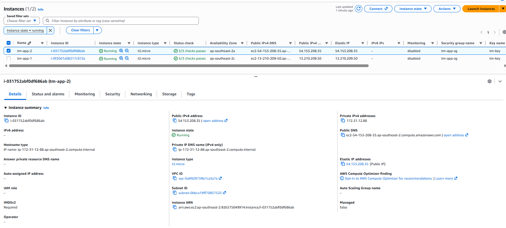
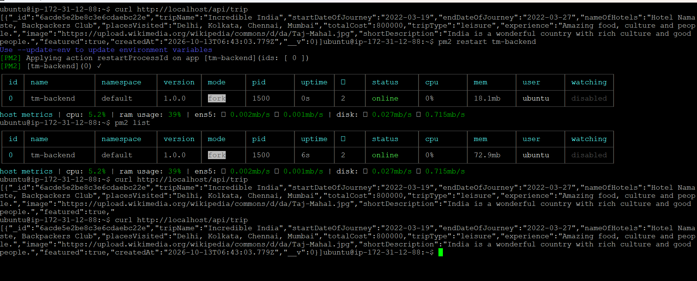
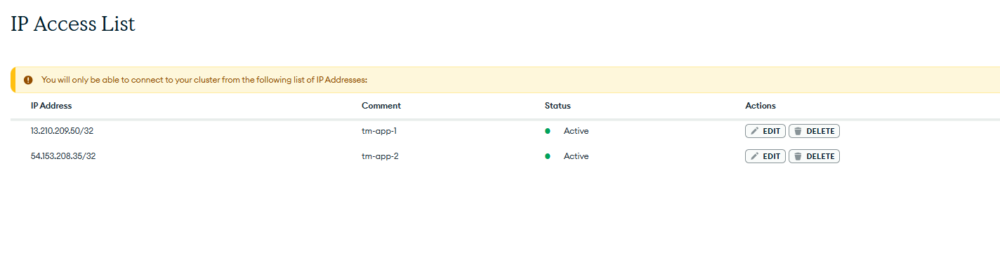

### Step 14 – Application Load Balancer

**Target group `tm-tg`:** target type Instances, HTTP:80, health check `GET /` (interval 30 s, healthy threshold 5, unhealthy threshold 2, success code 200), targets `tm-app-1` and `tm-app-2`.

**Load balancer `tm-alb`:** Application Load Balancer, internet-facing, IPv4, subnets in `ap-southeast-2a` and `ap-southeast-2c`, security group `tm-alb-sg`, listener HTTP:80 → `tm-tg`.

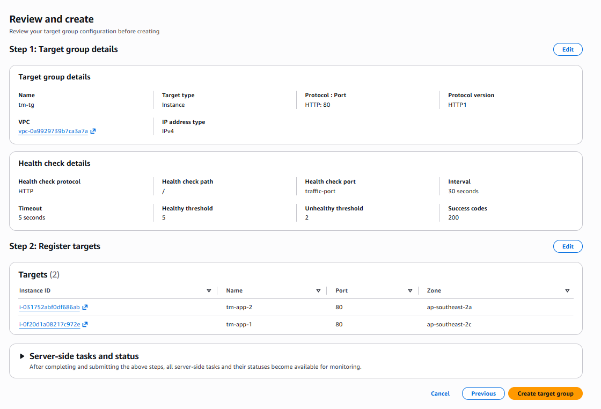
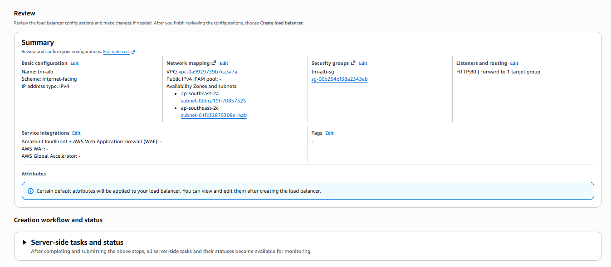
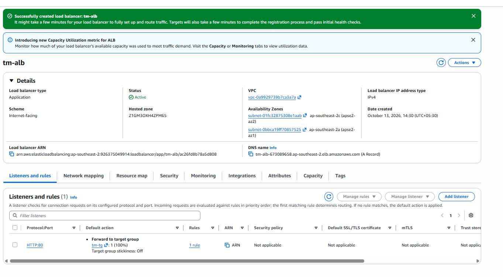
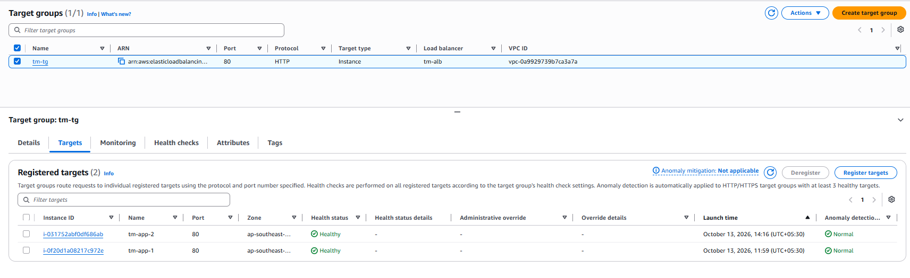

Verified through the ALB DNS name:

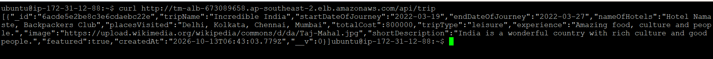
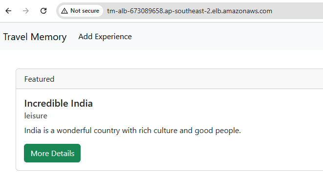

**Load-balancing proof:** the nginx access logs on both servers (health checks filtered out) while sending ten requests in a row. The requests alternate between `tm-app-1` (left) and `tm-app-2` (right). The client IPs are `172.31.x.x` because the ALB forwards requests on behalf of visitors.

```bash
sudo tail -f /var/log/nginx/access.log | grep -v ELB-HealthChecker
```

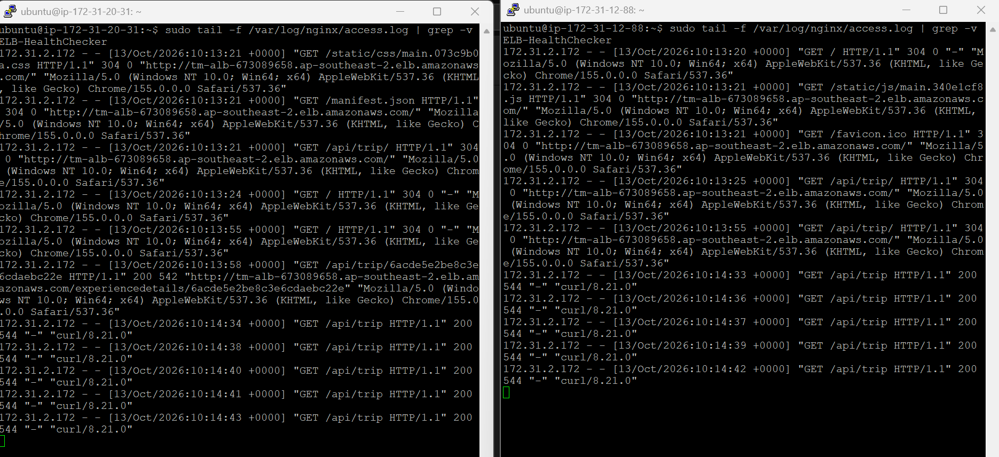

### Step 15 – Restrict direct access to Cloudflare only

The A record sends Cloudflare traffic straight to EC2-1. Instead of opening port 80 to the whole internet:

1. Created **`tm-direct-sg`** with 15 inbound HTTP rules, one for each [Cloudflare IPv4 range](https://www.cloudflare.com/ips-v4).
2. Attached it to **`tm-app-1` only** (`tm-app-2` keeps only `tm-app-sg`).
3. Removed the temporary "HTTP 80 from admin IP" test rule from `tm-app-sg`.

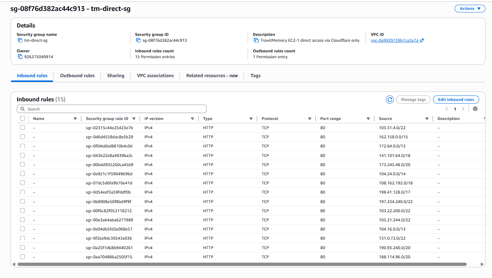
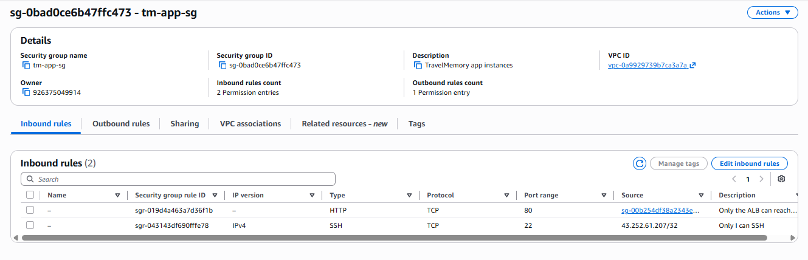
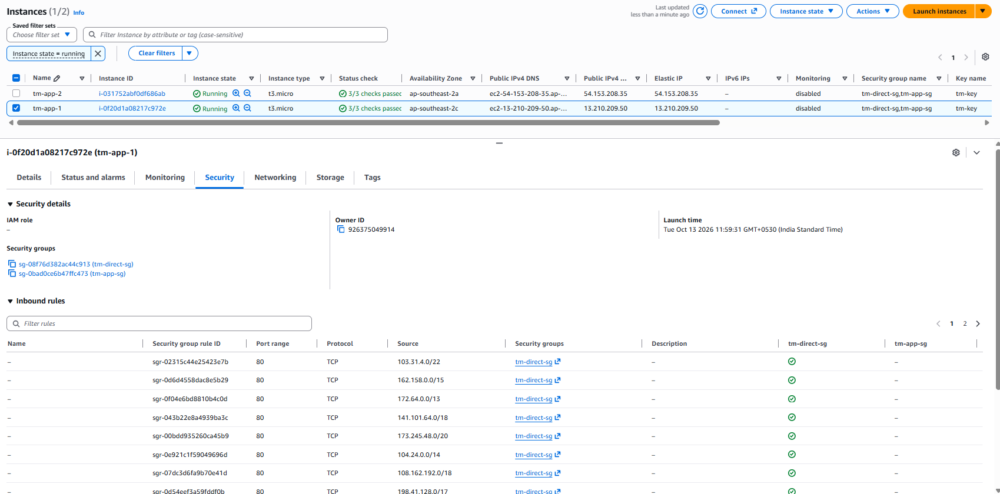


### Step 16 – Cloudflare DNS and TLS

| Type | Name | Target | Proxy |
|---|---|---|---|
| CNAME | `travelmemory` | `tm-alb-673089658.ap-southeast-2.elb.amazonaws.com` | Proxied |
| A | `travelmemory-fe` | `13.210.209.50` (Elastic IP of EC2-1) | Proxied |

- **SSL/TLS mode: Flexible.** Browser ↔ Cloudflare is HTTPS, Cloudflare ↔ AWS is HTTP, because the origins only listen on port 80.
- **Always Use HTTPS** is on, so HTTP visitors are redirected to HTTPS.


**Final result:**


---

## 5. Security measures

| Area | Measure |
|---|---|
| Network | Backend port 3000 never exposed; only nginx on port 80 |
| Network | App instances accept HTTP only from the ALB security group |
| Network | Direct access to EC2-1 only from Cloudflare IP ranges (`tm-direct-sg`) |
| Access | SSH restricted to the administrator's IP; key-based authentication |
| Database | Atlas IP access list limited to the two Elastic IPs (no `0.0.0.0/0`) |
| Database | Least-privilege DB user: `readWriteAnyDatabase`, scoped to the one cluster, not Atlas admin |
| Secrets | Credentials only in `.env` (`chmod 600`), excluded by `.gitignore`; `.env.example` holds placeholders only |
| Secrets | A database user whose password was exposed during setup was deleted and replaced |
| Compute | EBS volumes and the AMI snapshot encrypted (KMS `aws/ebs`); AMI kept private |
| Compute | IMDSv2 required on both instances |
| Web server | `server_tokens off` hides the nginx version |
| Transport | HTTPS for users via Cloudflare; Always Use HTTPS enabled |
| Accounts | 2FA enabled on Cloudflare |

---

## 6. Scalability and resilience

- **Horizontal scaling:** two identical instances behind an ALB. More capacity is added by launching another instance from `tm-app-ami-v1` and registering it in `tm-tg`.
- **High availability:** the instances run in two Availability Zones (2a and 2c). If one AZ or instance fails, the ALB health check removes it and the other keeps serving.
- **Self-healing process:** pm2 restarts the backend on crash and after reboots (verified with a reboot test).
- **Stateless app tier:** all data lives in MongoDB Atlas, so any instance can serve any request.
- **Stable addressing:** Elastic IPs keep the A record and the Atlas allow list valid across stop/start.

---

## 7. Issues faced and how they were solved

| Issue | Cause | Resolution |
|---|---|---|
| Other regions showed "Access denied" | AWS Free plan account is locked to one region (Sydney) | Kept all AWS resources in Sydney and recreated the Atlas cluster in Sydney to co-locate app and DB |
| Instance launched with the wrong AMI and unencrypted disk | Launched before the settings were changed | Terminated it and relaunched with Ubuntu 24.04 and encrypted EBS before installing anything |
| `curl` returned 502 right after `pm2 restart` | nginx was ready before Node finished starting | Waited a few seconds and retried; 502 here only means the upstream wasn't ready |
| Browser blocked the new IP/domain on the office network | Corporate web filter blocks "Unrated" (new) sites | Added a narrow URL exemption for the test IP and `*.kamalvasvani.com` instead of allowing the whole category |
| `sed` for `server_tokens` in `nginx.conf` had no effect | The pattern did not match the default file | Added `server_tokens off;` directly in the site config |
| Duplicate trip in the database | Form submitted twice (double click) | Deleted the duplicate in Atlas Data Explorer |
| `reboot` failed with "Interactive authentication required" | Rebooting requires root | Used `sudo reboot` |

---

## 8. Known limitations and future improvements

- **Flexible SSL:** traffic between Cloudflare and AWS is unencrypted HTTP. Improvement: an ACM certificate on an ALB HTTPS:443 listener and a Cloudflare Origin Certificate on nginx, then switching Cloudflare to **Full (strict)**.
- **ALB open to the internet:** `tm-alb-sg` could be restricted to Cloudflare IP ranges so all traffic must pass through Cloudflare.
- **Manual scaling:** an Auto Scaling Group with a launch template based on `tm-app-ami-v1` would replace failed instances and scale automatically.
- **Secrets inside the AMI:** the `.env` is baked into the private AMI. AWS Systems Manager Parameter Store or Secrets Manager would be the production approach.
- **Outdated dependencies:** `npm audit` reports vulnerabilities in upstream packages; these should be upgraded and retested.
- **Single Node process per instance:** pm2 cluster mode could use both vCPUs.
- **No CI/CD:** a pipeline could build the frontend and roll out new AMIs automatically.

---

## 9. Cost and teardown

All resources run on the AWS Free plan credits and the MongoDB Atlas M0 free tier. The ALB and public IPv4 addresses are billable items covered by the credits.

To tear down after evaluation:

1. Delete the load balancer `tm-alb`, then the target group `tm-tg`.
2. Terminate `tm-app-1` and `tm-app-2`.
3. Release both Elastic IPs (unattached Elastic IPs are still charged).
4. Deregister `tm-app-ami-v1` and delete its EBS snapshot.
5. Delete the security groups and the key pair.
6. Remove the two Cloudflare DNS records and terminate the Atlas cluster if no longer needed.
